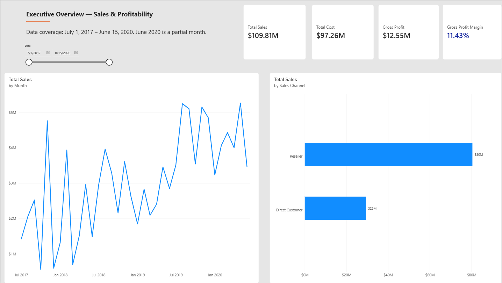
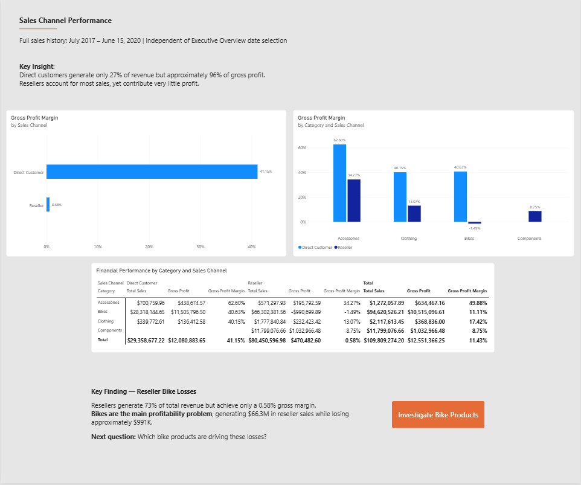

# AdventureWorks Sales Analytics | Power BI 
## Project Overview 

An interactive, seven-page Power BI report exploring sales performance, profitability, sales channels, products, and territories using AdventureWorks data. The project moves from executive-level monitoring to focused investigations of reseller bike losses and a sharp decline in profitability in June 2020.

## Business Challenge
Revenue alone does not reveal whether sales are profitable. This analysis examines which channels, products, and territories contribute to gross profit—and investigates a period when sales increased while gross profit fell sharply.

Reporting period: July 1, 2017 – June 15, 2020. June 2020 contains only the first 15 days of recorded sales.

## Business Questions 
- How much revenue and gross profit does the business generate?
- How do direct-customer and reseller channels differ in profitability?
- Which bike models contribute most to reseller losses?
- Where are reseller bike losses concentrated geographically?
- How have sales and gross profit changed over time?
- What changed between May 1–15 and June 1–15, 2020?

## Tools and Techniques 
- Power BI Desktop: Interactive report design, page navigation, slicers, bookmarks, and drill-downs
- Power Query: Data preparation and sales-channel classification
- DAX: Measures for sales, cost, gross profit, gross profit margin, and dynamic chart titles
- Data modeling: Relationships across sales, date, product, customer, reseller, and territory tables
- Analytical design: Channel, product, territory, and comparable-period profitability analysis

## Key findings

### 1. Revenue and profitability differ substantially by channel 

Across the reporting period, total sales were approximately $109.81M, generating $12.55M in gross profit (11.43% gross profit margin).
- Reseller: Approximately 73% of revenue, but a gross profit margin of only 0.58%.
- Direct Customer: Approximately 27% of revenue, but a gross profit margin of 41.15%, contributing roughly 96% of total gross profit.

### 2. Reseller bikes are a major profitability concern 

Reseller bike sales generated approximately $66.30M in revenue but −$990.70K in gross profit, equivalent to a −1.49% margin. Model-level analysis highlights substantial losses on Touring-1000, while other bike models are profitable.

Territory analysis shows that the United States has the largest absolute reseller bike loss, while Australia has the lowest reseller bike gross profit margin (approximately −9.98%).

### 3. June 2020 warrants focused investigation 

To avoid comparing a partial June with a full May, the report compares May 1–15 with June 1–15, 2020.
- Sales increased by approximately 28.6%.
- Gross profit declined by approximately 96.8%.
- No direct-customer bike transactions were recorded in the June comparison period.
- Recorded June bike transactions were in the reseller channel, with bike gross profit of approximately −$72.25K.

**Further investigation required:** The available data does not establish why direct-customer bike transactions were absent during June 1–15, 2020. Validation against sales operations or source-system records would be needed before assigning a cause.

## Report walkthrough
| Page | Purpose |
|---|---|
| Executive Overview | Headline sales, cost, gross profit, margin, and revenue trends |
| Sales Channel Performance | Compare channel profitability and identify reseller bike losses |
| Reseller Bike Loss Analysis | Investigate loss-making bike products and models |
| Territory Performance | Examine reseller bike losses by country and model |
| Sales Trends | Explore monthly revenue and gross profit across the available history |
| Profitability Investigation | Compare May 1–15 and June 1–15, 2020 |
| Product Investigation | Drill into category, channel, model, and product details |

The final investigation page is hidden from the main tab navigation and accessed through the report's Investigate Further button.

## Report screenshots 
### Executive Overview

### Sales Channel Performance

## Data and interpretation notes 
- The report uses AdventureWorks sample sales data.
- The latest available sales date is June 15, 2020; June is not a complete calendar month.
- The May–June comparison uses the first 15 days of each month to keep the periods comparable.
- The report describes observed patterns and does not claim an unverified cause for missing direct-customer bike transactions.
- Figures are rounded in this README; report visuals provide additional detail.

## Project files 
The Power BI .pbix report and selected screenshots will be added after verifying that the underlying data can be shared publicly.

## Skills demonstrated 
Data transformation · Relational data modeling · DAX measures · KPI design · Profitability analysis · Interactive navigation · Slicers and filter context · Dynamic titles · Drill-down investigation · Analytical storytelling
